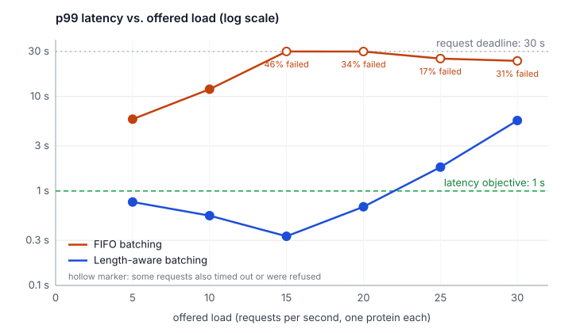

# Why FIFO batching collapses: a padding feedback loop in protein-model serving

*Same model, same CPU, same traffic. With one batching policy the slowest 1%
of requests finish in a third of a second; with the other, almost half of
them time out. This post explains why, with the measurements and code to
reproduce them.*

---

I'm building a small, cost-conscious platform for serving protein language
models ([repository](../../README.md)). Its first model is
[ESM-2](https://github.com/facebookresearch/esm), which turns a protein
sequence into a vector that biologists use for search, clustering and
property prediction. This post is about one decision in its serving layer,
how to group requests into batches, and how the obvious choice falls into
a feedback loop under load.

## Proteins make padding expensive

A transformer processes a batch as a rectangle. Every sequence in the batch
is padded to the length of the longest one, and the padding positions cost
as much compute as real ones while producing nothing.

For text chatbots this is a known nuisance. For proteins it's worse, because
lengths vary a lot. In the 300 reviewed human proteins I use as a sample,
lengths run from 47 to 991 amino acids (median 420). Put a 50-residue
protein in a batch with a 1,000-residue one and 95% of its row is padding.

I first measured this offline, in a batch job that embeds a file of
proteins. Batching eight at a time in file order wasted **42%** of all
computed positions on padding. Sorting by length and packing each batch up
to a token budget cut that to **5%** and doubled throughput, with the same
embeddings to within floating-point tolerance (a test checks that batching
never changes a protein's vector).

Offline, sorting is easy: you have the whole file. Online, requests arrive
one by one from different callers, and you can't wait for "all of them".

## The serving setup

Lab users call an HTTP API with one or a few sequences. A gateway, written
in Rust, queues the sequences, forms batches and sends them to a model
server (Python, PyTorch) that runs whatever batch it is given, one at a
time. While the model server is busy, the queue fills; when it is free,
the gateway sends the next batch. Each sequence's result is routed back to
its own request, so a batch can mix callers.

The interesting part is which queued sequences go together. I compared two
policies:

- **FIFO.** Take sequences in arrival order until a token budget is full
  (batch size × (longest + 2) ≤ 8,192). This is the simplest form of dynamic
  batching.
- **Length-aware.** The *oldest* queued sequence always goes in the next
  batch, so nothing can wait forever. Then, repeatedly, add the sequence
  that adds the least padding, but only while the batch stays within the
  token budget **and its padding stays under 10%**.

That last rule turned out to matter. Without it, a long protein at the head
of the queue drags short ones into its batch and pads them out. With it,
the short ones wait a moment and run in a batch of their own. It also has a
useful side effect: if no batch can exceed 10% padding, total padding can't
either, so the platform's "at most 10% padding" objective holds by
construction. Property tests check this rule and the others (nothing lost
or duplicated, oldest always included, batches as full as the rules allow)
against about a thousand random queues.

## Measuring it honestly

The load generator is **open-loop**: it sends requests at random
(Poisson-distributed) times at a fixed average rate, whether or not earlier
requests have finished, like independent users would. Latency is measured
from each request's *scheduled* send time.

That detail matters. The common alternative, N clients each waiting for its
previous answer before sending the next request, slows down exactly when
the system does, sends less load when it is struggling, and reports
flattering latencies. This is known as *coordinated omission*, and it would
have hidden most of what follows.

Each request carried one sequence of random amino acids, with lengths drawn
from the 300 real proteins (cost depends on length, not content, so no real
data was needed). The model was ESM-2 with 8M parameters on 2 CPU threads.
Each step ran 30 seconds after a 5-second warm-up, with a 30-second deadline
per request.

## The result



| Load (req/s) | FIFO p99 | FIFO padding | Length-aware p99 | Length-aware padding |
|---|---|---|---|---|
| 5 | 5.8 s | 22% | **0.76 s** | 0.3% |
| 10 | 12.0 s | 44% | **0.55 s** | 0.9% |
| 15 | 30 s, 46% timed out | 50% | **0.33 s** | 1.0% |
| 20 | 30 s, 34% failed | 44% | **0.68 s** | 2.1% |
| 25 | 25 s, 17% refused | 46% | 1.8 s | 5.0% |
| 30 | 24 s, 31% refused | 46% | 5.6 s | 5.9% |

Length-aware batching keeps the slowest 1% of requests under a second up to
20 requests per second. FIFO is already at 5.8 seconds at 5 requests per
second, and at 15 almost half its requests time out. At the same latency
target, length-aware batching carries three to four times the load.

## The feedback loop

The surprising part is *how* FIFO fails. At 5 requests per second the model
server is mostly idle, yet FIFO's p99 is 5.8 seconds. The mean batch size
explains it: 1.76 sequences for FIFO, against 1.04 for length-aware.

Whenever two requests happen to be waiting at the same moment, which random
arrivals guarantee now and then, FIFO puts them in one batch regardless of
their lengths. A short protein is padded to the length of a long one. That
batch takes longer than the two sequences would have taken on their own,
so more requests arrive while it runs, so the next batch is bigger and more
mixed, so it carries more padding, so it takes longer still:

```
   mixed batch ──▶ padding ──▶ more compute per batch
        ▲                              │
        │                              ▼
  bigger batches ◀── longer queue ◀── slower batches
```

By 10 requests per second FIFO's batches average 9.4 sequences, and 44% of
everything the CPU computes is padding. The system spends almost half its
capacity on zeros, at exactly the moment it is short of capacity. Even at
its best, FIFO delivered at most about 8,900 residues per second of real
work; length-aware batching reached 13,400 and was still keeping up.

Length-aware batching breaks the loop at the first arrow. It only combines
sequences of similar length, so a batch costs roughly what its real
residues cost, and a busy moment doesn't make the next moment more
expensive. Its batches stay small (1.04 to 1.26 sequences up to 20 requests
per second) because nothing is waiting. It batches when batching is free,
not by default.

Above saturation, FIFO also shows **congestion collapse**: with a large
queue, requests wait so long that they hit their deadline after the model
has already spent compute on them. That compute produces no answer, and
the useful throughput falls.

## Three smaller lessons

**Waiting to fill a batch doesn't help here.** Many batchers wait a few
milliseconds for company before sending. At 15 requests per second, a
10 ms wait doubled p99 (0.16 s to 0.32 s) for no gain in throughput; near
saturation, runs with different random arrivals varied more than runs with
different waits. The reason: the gateway sends nothing while the model
server is busy, so batches form on their own exactly when there is load. I
set the wait to zero.

**A queue limit is a dial between latency and refusals.** Beyond capacity,
something has to give. With a queue limit of 131,072 tokens, p99 at 35
requests per second was 7.1 s. With 16,384 tokens (about 1.2 seconds of
work), it was 3.0 s, at the cost of refusing 7% of requests with a
`503 Retry-After` in milliseconds. A fast "no" lets a client back off or go
elsewhere; a slow "yes" just times out later.

**One batcher per model server.** Moving from the laptop to a Kubernetes
cluster turned up one more effect: with two gateway replicas in front of one
model server, p99 was three to four times worse than with one. Each gateway
batched half the traffic on its own, and their batches then queued
first-come, first-served inside the model server, where length-awareness no
longer applies. Running the gateway in the same pod as the model server,
one to one, fixed it; the model server is a Kubernetes native sidecar, so
it starts before the gateway and stops after the gateway has drained. A
rollout under steady traffic answered 395 of 395 requests.

## Limits

- One laptop (4 performance and 6 efficiency cores) runs the load
  generator, gateway and model server, so timings are noisy; most points
  are single runs. Near capacity, results depend strongly on the random
  arrival pattern.
- One small model (8M parameters) on CPU. I expect the loop on GPUs too,
  since it only needs padded positions to cost real time, but the numbers
  will differ and I haven't measured them yet. That is next.
- One sequence per request. Requests with many sequences of different
  lengths are not measured yet.

## Takeaways

1. **If input lengths vary, a batching policy is a padding policy.** FIFO
   lets padding grow with load, which turns load into more load.
2. **Bound padding per batch, not just on average.** A per-batch cap stops
   the loop and makes the efficiency objective hold by construction.
3. **Measure open-loop.** A closed-loop tester would have made FIFO look far
   better than it is.
4. **Batch where the model is.** Two independent batchers in front of one
   model undo the policy.

## Code and data

- Gateway and batching policy: [`services/gateway`](../../services/gateway)
  (the policy is [`batcher.rs`](../../services/gateway/src/batcher.rs),
  with its property tests)
- Load generator: [`loadgen`](../../services/gateway/src/bin/loadgen/main.rs)
- Full method, all tables and raw results:
  [load tests](../benchmarks/gateway-load-tests.md),
  [`bench/results/`](../../services/gateway/bench/results)
- Design: [inference gateway](../design/gateway.md)

To reproduce, start a model server and run
`services/gateway/bench/run.sh <name> "--batching fifo" "--rates 5,10,15"`;
the chart is drawn from the results by `scripts/plot_batching_latency.py`.
